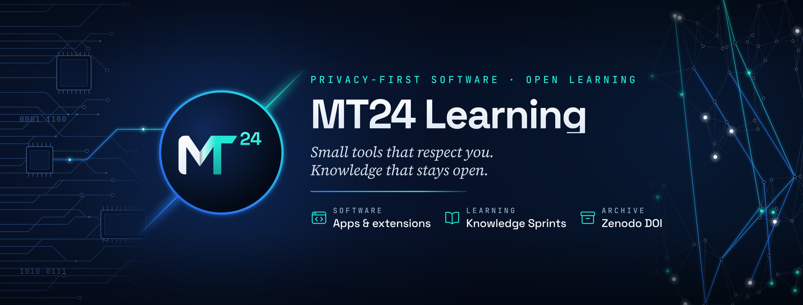

  

<b>Privacy-first software and open learning by Mohammed Tahri (MT24).</b>

---

### Software

| Product | What it is | Status |
| --- | --- | --- |
| **[SiteDNA](https://mt24learning.github.io/SiteDNA/)** | A Chrome extension that reads the design DNA of any website: colors, fonts, images, a consistency and WCAG contrast audit, and design tokens. Free, with a one-time PRO upgrade. | In review on the Chrome Web Store |
| **Deepfolio** | A free, open-source offline vault for Android and desktop. Passwords, cards, IDs, CVs and documents stay encrypted on your device. | In development |

More apps and extensions will join this list. Each one follows the same rule: your data stays yours.

### Learning

**[Knowledge Sprint Series](https://github.com/MT24Learning/knowledge-sprint-series)** — a free visual learning series, published sprint by sprint. Every completed phase is archived with a citable DOI in the [MT24 Learning community on Zenodo](https://zenodo.org/communities/mt24-learning).

*The empty set — where every proof begins.*

### How we work

- Your data stays on your device.
- Small, focused tools that do one job well.
- Learning in the open, archived and citable.

### Contact

Support: mt24learning.support@gmail.com  
[LinkedIn](https://www.linkedin.com/in/mohammed-tahri24) · [X](https://x.com/MohammedTahri24) · [Bluesky](https://bsky.app/profile/mohammedtahri.bsky.social)
